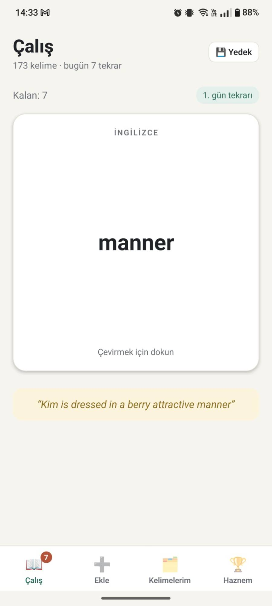
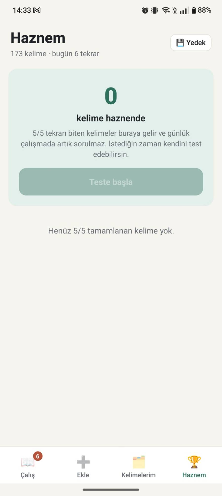
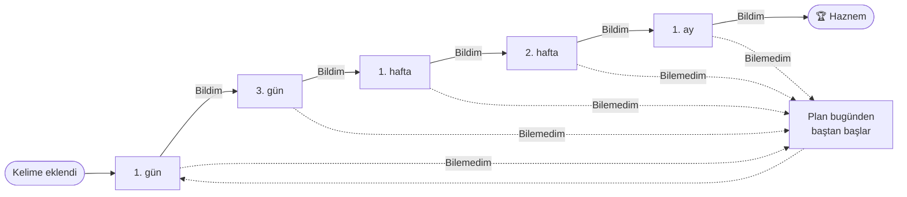

# 🃏 Kelime Kartları

**Kendi kelimelerini ekle, unutmadan önce tekrar et.**

Dizide, kitapta, haberde karşına çıkan İngilizce kelimeleri kaydettiğin ve *aralıklı tekrar* (spaced repetition) yöntemiyle 1. gün, 3. gün, 1. hafta, 2. hafta ve 1. ayda yeniden sorduğu sade bir mobil uygulama. Hesap yok, sunucu yok, reklam yok: her şey telefonunda kalır.


<p align="center">
  
  
  
  
  
</p>
<p align="center"><sub>Çalış (ön yüz ve ipucu) · Kartın arkası · Ekle · Takvim · Kelime Haznem</sub></p>

---

## ✨ Özellikler

| | |
|---|---|
| 📖 **Günlük çalışma** | Tarihi gelen kartlar çevirme animasyonlu kartlarla sorulur. Takılırsan 💡 ipucu örnek cümleyi gösterir. |
| 🔁 **Aralıklı tekrar** | Bildiğin kelime bir sonraki aşamaya geçer, bilemediğin baştan başlar. Kaçırılan günler birikmez. |
| 🏆 **Kelime Haznem** | 5/5 tekrarı biten kelimeler günlük çalışmadan çıkar, haznene geçer. İstediğin zaman hepsiyle karışık bir test yapabilirsin. |
| 📅 **Takvim** | Her günün altında o gün kaç kelime eklediğin yazar (+4, +7…). Güne dokununca o günün kelimeleri açılır. |
| ✗ **Zorlandıkların** | Her kelimenin kaç kez bilinemediği sayılır. Hangi kelimelerde zorlandığın bir bakışta görünür. |
| 🏷️ **Zengin kartlar** | Tür (noun, verb, adj, adv, phrase), örnek cümle, eş ve zıt anlamlılar, nerede gördüğün ve konu. Hepsi isteğe bağlı. |
| 🔍 **Arama** | İngilizce, Türkçe, örnek cümle ve eş/zıt anlamlılarda arar. Büyük/küçük harf ve ı/i, ö/o farkına takılmaz. |
| ✏️ **Her yerden düzenleme** | Çalışırken kartın arkasından ya da listeden düzenleyebilirsin. Düzenlemek tekrar planını bozmaz. |
| 💾 **Dosya ile yedek** | Tüm veriler tek bir `.json` dosyasına kaydedilir: Drive'a, Dosyalar'a, WhatsApp'a gönder. Yeni telefonda dosyayı seçip geri yükle. |
| ⚠️ **Tekrar uyarısı** | Aynı kelimeyi ikinci kez eklemeye çalışırsan uyarır. Farklı bir anlamı içinse yine de ekleyebilirsin. |

## 🔁 Tekrar nasıl çalışıyor?



- Kelime eklendiği gün sorulmaz, ertesi gün **Çalış** ekranına düşer.
- **Bildim:** Bir sonraki aşamaya geçer. **Bilemedim:** Plan o günden baştan başlar. Aynı gün tekrar sorulmaz.
- Birkaç gün giremezsen kartlar kaybolmaz, "Gecikti" olarak bekler. Tarihi çoktan geçmiş aşamalar atlanır, böylece aynı kelime aynı gün iki kez gelmez.
- **Haznem testi** tekrar planını değiştirmez, sadece sonucu kaydeder. Test bitince bilemediklerini istersen tek dokunuşla tekrar plana alabilirsin.
- Aralıkları değiştirmek için [`src/dates.js`](src/dates.js) içindeki `INTERVALS` ve `STAGE_LABELS` dizilerini düzenlemen yeterli.

## 🚀 Kurulum

```bash
git clone https://github.com/aliozcany/kelime-kartlari.git
cd kelime-kartlari
npm install
```

### Geliştirirken denemek

```bash
npx expo start
```

Telefondaki **Expo Go** uygulamasıyla QR kodu okut (bilgisayar ve telefon aynı Wi-Fi'de olmalı).

### Telefona APK olarak kurmak (Android)

```bash
npx eas-cli login
npx eas-cli build -p android --profile apk
```

Derleme Expo'nun sunucularında yapılır. Bitince verilen linki telefondan açıp APK'yı kur. Yeni sürümü eskisinin üstüne kurarsan kelimelerin silinmez.

> **Windows'ta** PowerShell `npx` için "running scripts is disabled" hatası verirse, `npx` yerine `npx.cmd` yaz.

## 🗂️ Proje yapısı

```
App.js                     Alt sekmeler, veri yükleme/kaydetme, Yedek düğmesi
src/
├── screens/
│   ├── StudyScreen.js     Günlük çalışma: kart çevirme, ipucu, Bildim / Bilemedim
│   ├── AddScreen.js       Yeni kelime ekleme
│   ├── ListScreen.js      Arama; gün / hafta / ay listesi ve takvim; düzenle, sil
│   └── VaultScreen.js     Kelime Haznem ve karışık test
├── components/
│   ├── FlipCard.js        Çevrilebilir kart (Çalış ve Haznem ortak)
│   ├── CardForm.js        Ekleme / düzenleme formu
│   ├── EditCardSheet.js   Düzenleme penceresi
│   ├── CalendarView.js    Ay takvimi (+N gösterimi)
│   ├── BackupSheet.js     Dosyaya yedekle / dosyadan geri yükle
│   └── Sheet.js           Alttan açılan pencere
├── srs.js                 Tekrar mantığı (bildim, bilemedim, test, hata sayısı)
├── dates.js               Tarih yardımcıları ve tekrar aralıkları
├── backup.js              Yedek oluşturma ve doğrulama
├── storage.js             Telefonda kalıcı kayıt (AsyncStorage)
└── theme.js               Renkler
```

## 🧩 Veri yapısı

Her kart telefonda (AsyncStorage) şu şekilde saklanır. Yedek dosyası da aynı yapıdadır:

```js
{
  id: "m3x9k2abcd",
  en: "reluctant",
  tr: "isteksiz, gönülsüz",
  types: ["adj"],                        // isteğe bağlı
  example: "She was reluctant to leave.", // isteğe bağlı
  synonyms: "unwilling, hesitant",       // isteğe bağlı
  antonyms: "eager, willing",            // isteğe bağlı
  reference: "Friends 3. sezon",         // isteğe bağlı
  topic: "Diziler",                      // isteğe bağlı
  createdAt: "2026-11-17",
  anchor: "2026-11-20",                  // planın son başladığı gün (bilinemediyse)
  stage: 2,                              // 0–4 tekrar aşaması, 5 = Haznem
  reviews: [{ date: "2026-11-18", ok: true }],
  tests:   [{ date: "2026-12-30", ok: false }]  // Haznem testleri
}
```

Tarihler yerel saatle `YYYY-MM-DD` metni olarak tutulur, böylece saat dilimi kaymaları olmaz.

## 🛠️ Teknolojiler

- [React Native](https://reactnative.dev/) + [Expo](https://expo.dev/) (SDK 57)
- `@react-native-async-storage/async-storage`: kalıcı kayıt
- `expo-file-system`, `expo-sharing`, `expo-document-picker`: yedek dosyası
- [EAS Build](https://docs.expo.dev/build/introduction/): APK derleme

Navigasyon, durum yönetimi ya da arayüz kütüphanesi kullanılmıyor; uygulama bilerek küçük ve bağımlılıksız tutuluyor.
