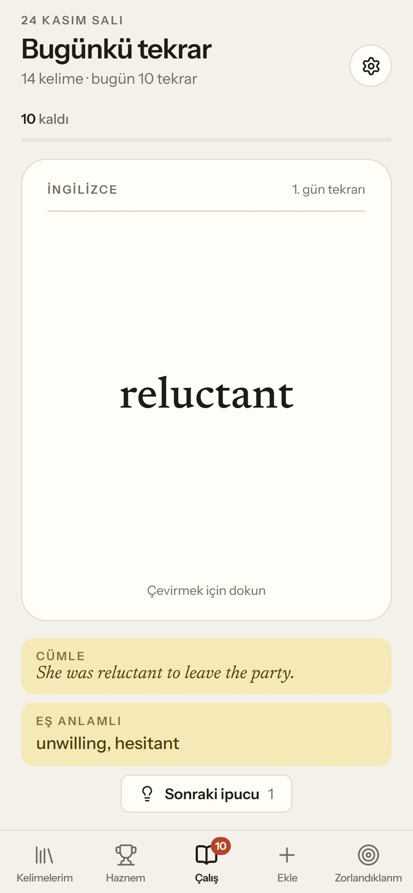
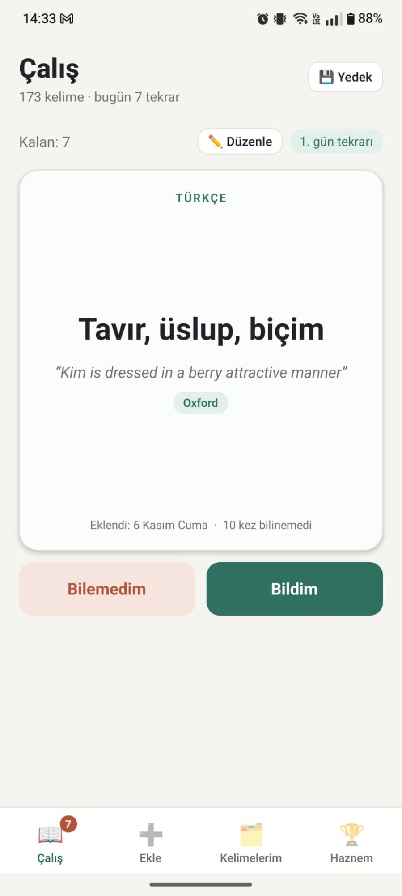
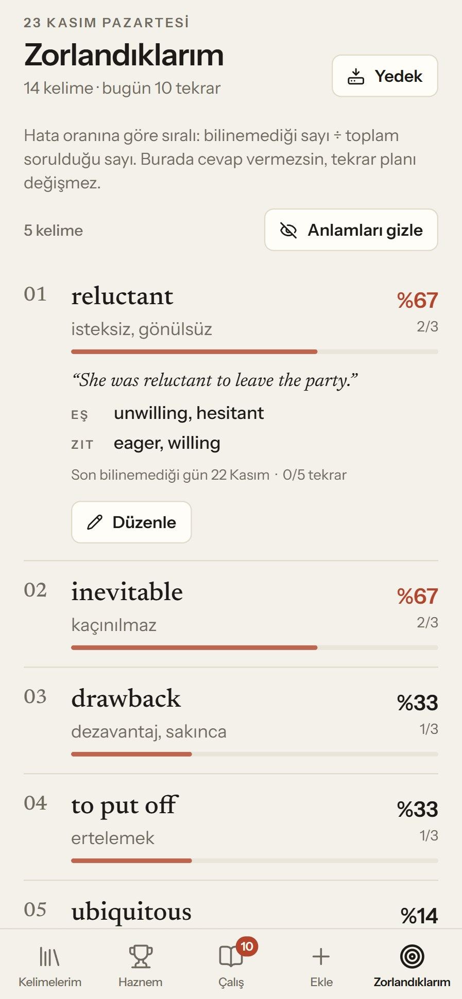
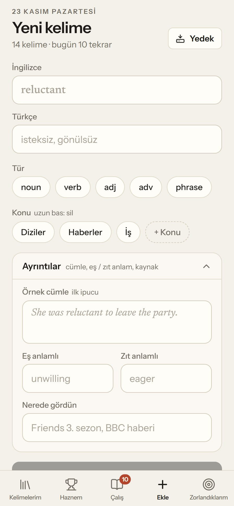
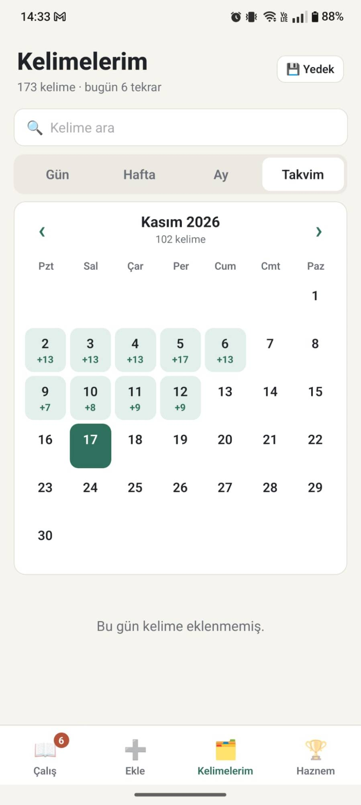
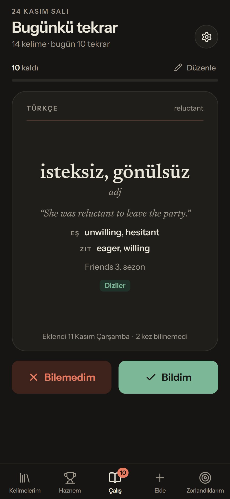
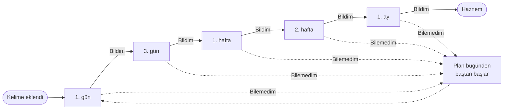

# Kelime Kartları

**Kendi kelimelerini ekle, unutmadan önce tekrar et.**

Dizide, kitapta, haberde karşına çıkan İngilizce kelimeleri kaydettiğin ve *aralıklı tekrar* (spaced repetition) yöntemiyle 1. gün, 3. gün, 1. hafta, 2. hafta ve 1. ayda yeniden sorduğu bir mobil uygulama. Hesap yok, sunucu yok, reklam yok: her şey telefonunda kalır.


<p align="center">
  
  
  
</p>
<p align="center">
  
  
  
</p>
<p align="center"><sub>Çalış ve ipuçları · Kartın arkası · Zorlandıklarım · Ekle · Takvim · Koyu tema</sub></p>

---

## Özellikler

**Çalış.** Tarihi gelen kelimeler çevrilebilir kartlarla sorulur; kartın önünde İngilizcesi, arkasında anlamı, türü, örnek cümlesi ve eş/zıt anlamlıları vardır. Takılırsan ipucu butonuna her basışta bir ipucu daha açılır: önce **örnek cümle**, sonra **eş anlamlı**, sonra **zıt anlamlı**. Kartta olmayan ipucu atlanır.

**Zorlandıklarım.** En az bir kez bilinemeyen kelimeler *hata oranına* göre sıralanır (bilinemediği sayı ÷ kaç kez sorulduğu). Burada cevap verilmez, tekrar planı değişmez; sadece bakıp çalışmak içindir. İstersen anlamları gizleyip dokundukça tek tek açarak kendini yoklayabilirsin.

**Ekle.** İngilizce, Türkçe, tür ve konu tek ekranda. Örnek cümle, eş/zıt anlamlılar ve "nerede gördün" katlanır *Ayrıntılar* bölümünde durur; bir kez açınca açık kalır. Aynı kelimeyi ikinci kez eklemeye çalışırsan uyarır. Klavye açıkken alanlar kapanmaz.

**Kelimelerim.** Gün, hafta, ay ya da takvim görünümü. Takvimde her günün altında o gün kaç kelime eklediğin yazar. İngilizce, Türkçe, örnek cümle ve eş/zıt anlamlılarda arama yapar; büyük/küçük harf ve ı/i, ö/o farkına takılmaz.

**Kelime Haznem.** 5/5 tekrarı biten kelimeler günlük çalışmadan çıkıp buraya geçer. İstediğin zaman hepsiyle karışık bir test yapabilirsin.

**Ayrıca:** Her yerden düzenleme (düzenlemek tekrar planını bozmaz) · tek dosyayla yedek ve geri yükleme · Ayarlar'dan açık/koyu/sistem teması ve çalışılan dil seçimi · uzun listelerde sayfa sayfa yükleme.

## Tekrar nasıl çalışıyor?



- Kelime eklendiği gün sorulmaz, ertesi gün **Çalış** ekranına düşer.
- **Bildim:** Bir sonraki aşamaya geçer. **Bilemedim:** Plan o günden baştan başlar. Aynı gün tekrar sorulmaz.
- Birkaç gün giremezsen kartlar kaybolmaz, "Gecikti" olarak bekler. Tarihi çoktan geçmiş aşamalar atlanır, böylece aynı kelime aynı gün iki kez gelmez.
- **Haznem testi** tekrar planını değiştirmez, sadece sonucu kaydeder. Test bitince bilemediklerini istersen tek dokunuşla tekrar plana alabilirsin.
- Aralıkları değiştirmek için [`src/dates.js`](src/dates.js) içindeki `INTERVALS` ve `STAGE_LABELS` dizilerini düzenlemen yeterli.

## Tasarım

Uygulama bir dizin kartı fikrinden yola çıkar: kâğıt rengi zemin, mürekkep siyahı yazı, kartın üstünde ince kırmızı çizgi ve ipuçlarında fosforlu kalem sarısı. Kelimeler sözlük havası veren tırnaklı [Newsreader](https://fonts.google.com/specimen/Newsreader), arayüz [Instrument Sans](https://fonts.google.com/specimen/Instrument+Sans) ile yazılır.

Renkler [`global.css`](global.css) içinde CSS değişkenleri olarak tanımlıdır (açık ve koyu tema). `className` kullanılamayan yerler (ikon rengi, placeholder) için aynı değerler [`src/theme.js`](src/theme.js) içinde de durur; birini değiştirirsen ötekini de değiştir.

## Kurulum

```bash
git clone https://github.com/aliozcany/kelime-kartlari.git
cd kelime-kartlari
npm install
```

### Geliştirirken denemek

```bash
npx expo start
```

Telefondaki **Expo Go** uygulamasıyla QR kodu okut (bilgisayar ve telefon aynı Wi-Fi'de olmalı). Bilgisayarda tarayıcıda açmak için `npx expo start --web`.

### Telefona APK olarak kurmak (Android)

```bash
npx eas-cli login
npx eas-cli build -p android --profile apk
```

Derleme Expo'nun sunucularında yapılır. Bitince verilen linki telefondan açıp APK'yı kur. Yeni sürümü eskisinin üstüne kurarsan kelimelerin silinmez.

> Yeni bir native paket eklendiğinde (ör. `react-native-keyboard-controller`, `expo-sqlite`) telefondaki eski APK yeni kodla çalışmaz; yeniden derlemek gerekir.

> **Windows'ta** PowerShell `npx` için "running scripts is disabled" hatası verirse, `npx` yerine `npx.cmd` yaz.

## Proje yapısı

```
App.js                     Alt sekmeler, fontlar, veri yükleme/kaydetme, Ayarlar düğmesi
global.css                 Tema renkleri (açık / koyu)
tailwind.config.js         Renk ve font tanımları
src/
├── screens/
│   ├── ListScreen.js      Kelimelerim: arama; gün / hafta / ay listesi ve takvim
│   ├── VaultScreen.js     Kelime Haznem ve karışık test
│   ├── StudyScreen.js     Çalış: kart çevirme, ipuçları, Bildim / Bilemedim
│   ├── AddScreen.js       Yeni kelime ekleme
│   └── HardScreen.js      Zorlandıklarım: hata oranına göre sıralı liste
├── components/
│   ├── ui/                Temel bileşenler: Text, Button, Input, Chip, Badge
│   ├── FlipCard.js        Çevrilebilir kart (Çalış ve Haznem ortak)
│   ├── HintPanel.js       Sırayla açılan ipuçları
│   ├── AnswerRow.js       Bilemedim / Bildim butonları
│   ├── CardForm.js        Ekleme / düzenleme formu
│   ├── EditCardSheet.js   Düzenleme penceresi
│   ├── CalendarView.js    Ay takvimi (+N gösterimi)
│   ├── SettingsSheet.js   Ayarlar: tema, çalışılan dil, yedek
│   ├── BackupSection.js   Dosyaya yedekle / dosyadan geri yükle
│   └── Sheet.js           Alttan açılan pencere
├── lib/                   cn() yardımcısı, NativeWind tanıtımları
├── srs.js                 Tekrar mantığı: bildim, bilemedim, test, hata oranı, ipuçları
├── dates.js               Tarih yardımcıları ve tekrar aralıkları
├── backup.js              Yedek oluşturma ve doğrulama
├── settings.js            Tema ve dil ayarları (SettingsProvider)
├── storage.js             Telefondaki SQLite veritabanı (okuma, tek kart yazma, ilk açılışta taşıma)
└── theme.js               className kullanılamayan yerler için renkler
```

## Veri yapısı

Uygulama içinde ve yedek dosyasında her kart şu yapıdadır:

```js
{
  id: "m3x9k2abcd",
  en: "reluctant",
  tr: "isteksiz, gönülsüz",
  types: ["adj"],                        // isteğe bağlı
  example: "She was reluctant to leave.", // isteğe bağlı, 1. ipucu
  synonyms: "unwilling, hesitant",       // isteğe bağlı, 2. ipucu
  antonyms: "eager, willing",            // isteğe bağlı, 3. ipucu
  reference: "Friends 3. sezon",         // isteğe bağlı
  topic: "Diziler",                      // isteğe bağlı
  createdAt: "2026-11-17",
  anchor: "2026-11-20",                  // planın son başladığı gün (bilinemediyse)
  stage: 2,                              // 0–4 tekrar aşaması, 5 = Haznem
  reviews: [{ date: "2026-11-18", ok: true }],
  tests:   [{ date: "2026-12-30", ok: false }]  // Haznem testleri
}
```

Tarihler yerel saatle `YYYY-MM-DD` metni olarak tutulur, böylece saat dilimi kaymaları olmaz. Hata oranı `reviews` ve `tests` kayıtlarından hesaplanır, ayrıca saklanmaz. `en` alanı, Ayarlar'da seçilen dildeki kelimedir (adı eski sürümlerle uyum için kaldı).

Telefonda veriler `kelime-kartlari.db` adlı bir SQLite dosyasında durur (sunucu yok, internet gerekmez):

| Tablo | İçerik |
| --- | --- |
| `cards` | Kartın alanları; bilinmeyen/yeni alanlar `extra` sütununda JSON |
| `answers` | Her cevap bir satır: `kind` = `review` (günlük tekrar) ya da `test` (Haznem) |
| `topics` | Konu adları |
| `meta` | Şema sürümü, eski kayıtların taşındığı zaman |

Bir kart değişince sadece o kartın satırları yazılır. Eski sürümlerden (AsyncStorage) gelen veriler ilk açılışta bir kez SQLite'a taşınır; eski kayıt silinmez.

## Teknolojiler

- [React Native](https://reactnative.dev/) + [Expo](https://expo.dev/) (SDK 57)
- [NativeWind](https://www.nativewind.dev/) (Tailwind CSS) ve [React Native Reusables](https://reactnativereusables.com/) tarzında bileşenler (`class-variance-authority`, `tailwind-merge`)
- [Lucide](https://lucide.dev/) ikonlar, `expo-font` ile Google Fonts
- `react-native-keyboard-controller`: klavye açıkken formun kayması
- `expo-haptics`: cevap verince titreşim
- `expo-sqlite`: kelimelerin kalıcı kaydı
- `@react-native-async-storage/async-storage`: küçük ayarlar (tema, dil) ve eski sürümden taşıma
- `expo-file-system`, `expo-sharing`, `expo-document-picker`: yedek dosyası
- [EAS Build](https://docs.expo.dev/build/introduction/): APK derleme
